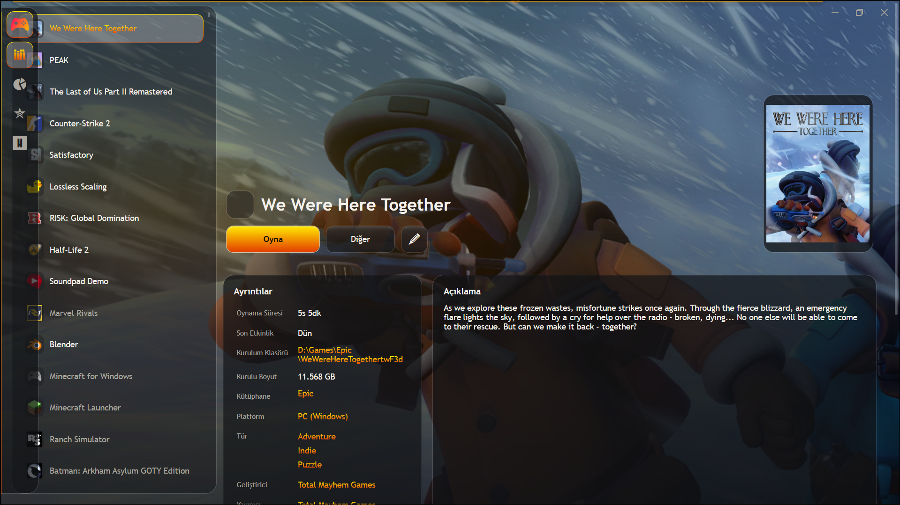
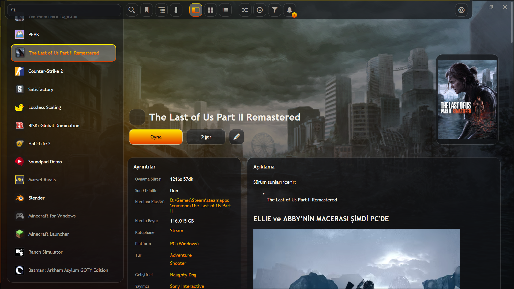
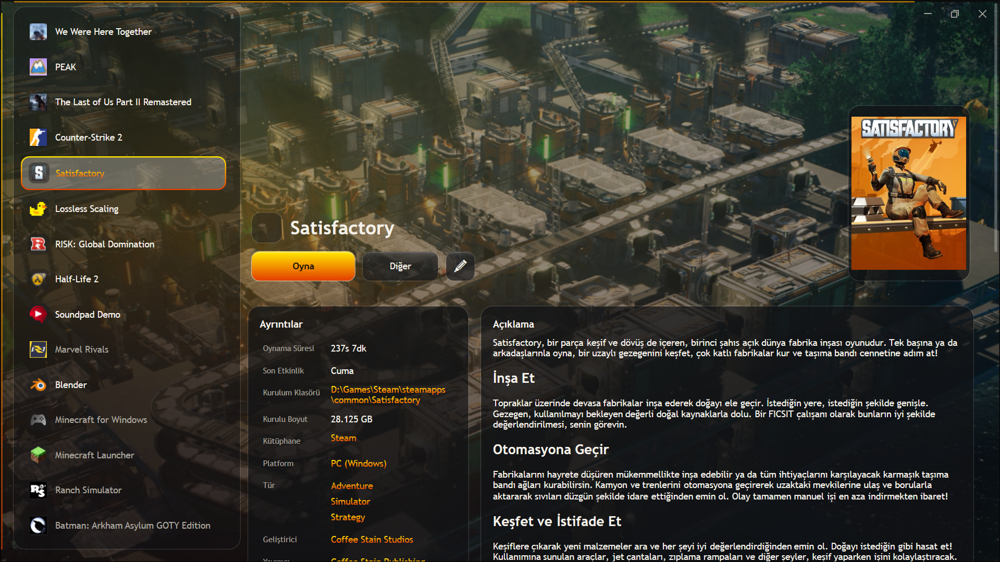
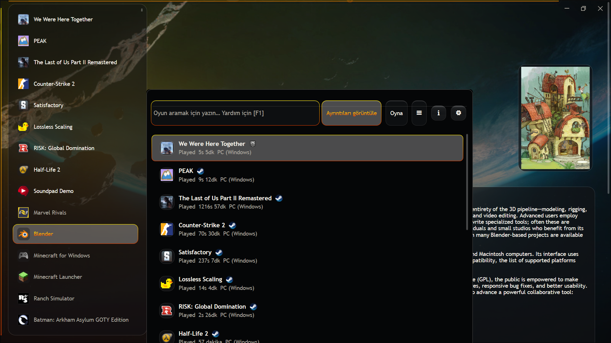
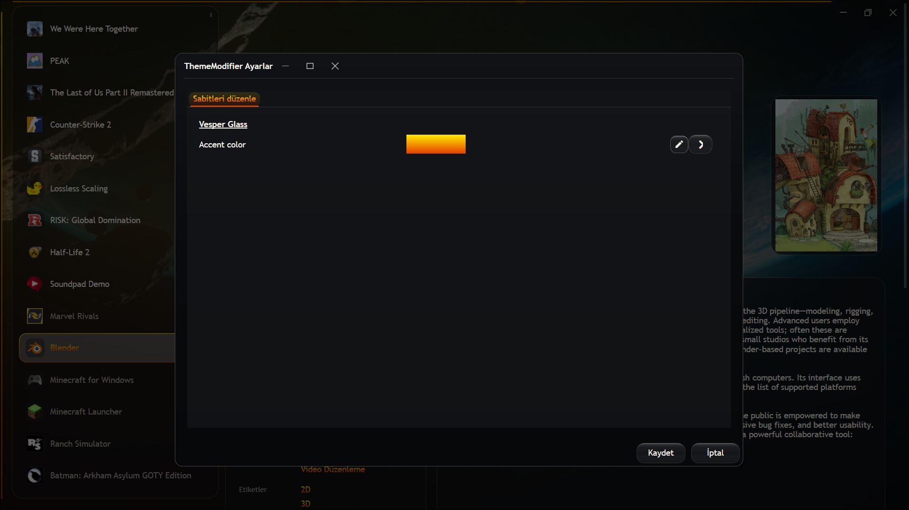

# Vesper Glass

Vesper Glass is a dark, neo-minimalist glass theme for Playnite Desktop Mode. It pairs tactile translucent surfaces with a vivid amber accent, full-library backdrop treatment, and animated edge panels.

## Preview

### Library details · Auto-hide panels: left navigation, top toolbar, and right filters

Move the pointer to the left, top, or right screen edge to reveal the corresponding panel.

  
  

  
  

### Accent color configuration

  

## Download and install

### Install from Playnite — recommended

This is the normal installation path and the only one that receives Playnite-managed updates. The Vesper Glass listing is currently awaiting approval in the official Add-on Database. Once approved, open [Vesper Glass in the Playnite Add-on Browser](https://playnite.link/addons.html#VesperGlass_9d17c9d1-9c6e-4f26-80f0-dcb7ea9d0c43), choose **Install**, select **Save**, and restart Playnite when prompted.

[Install Vesper Glass in Playnite](playnite://playnite/installaddon/VesperGlass_9d17c9d1-9c6e-4f26-80f0-dcb7ea9d0c43)

**Updates:** Playnite detects newer packages from the official listing. You do not need to download every new version yourself.

### Download `VesperGlass-2.9.0.pthm` — manual alternative

[Download VesperGlass-2.9.0.pthm](https://github.com/huseyincancalti/VesperGlass/raw/main/packages/VesperGlass-2.9.0.pthm)

1. Download the file above.
2. Double-click `VesperGlass-2.9.0.pthm`, or drag it onto an open Playnite window.
3. Accept the installation prompt and restart Playnite if requested.
4. Select **Vesper Glass** in `Settings…` > `Appearance` > `General` if it is not applied automatically.

**Updates:** Manual installations do not update automatically. Download and open the newer `.pthm` file when you want to update.

## Highlights

- Dark, cinematic acrylic surfaces with tactile borders and controlled depth.
- A vivid amber accent system with consistent hover, selection, and notification states.
- Full-library background treatment behind the game list and details views.
- Animated top, sidebar, and filter panels.
- ThemeModifier support for replacing the default amber accent color.

## Accent color

The default accent is amber. If you use the ThemeModifier extension, open its Vesper Glass entry and change **Accent color**. Restart Playnite after changing the value.

## Known issue

The auto-hide edge panels can briefly jitter when the pointer is held exactly on a screen edge. Moving the pointer a few pixels inward or away from the edge restores normal behavior. This is tracked as a UI issue and will be addressed in a future update.

## Updating

The Playnite Add-on Browser is the recommended update path. Manual installations can be updated by installing the newer `.pthm` package over the existing theme and restarting Playnite.

## Support

Please report reproducible issues through [GitHub Issues](https://github.com/huseyincancalti/VesperGlass/issues), including your Playnite version, Windows version, and screenshots where relevant.

## License

Vesper Glass is released under the [MIT License](LICENSE).
